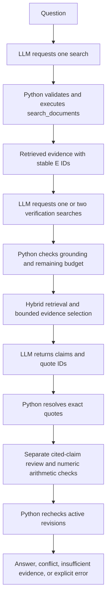

# Slice 6: follow evidence through a bounded investigation

**Current workflow update (28 October 2026):** the original slice's observed runs below used
three language-model calls. The current `bounded_tools_verified_v2` adds one bounded claim
review after drafting. [Grounding walkthrough](claim-grounding.md) explains the new behavior,
development-only evidence and limitations. The earlier run receipts remain historical.

The API runs real model-requested searches. Work stays on `main`. The
[slice-7 React workflows](react-workflows.md) now expose these searches and citations through
the website; `/docs` remains available. The full corpus import has completed: a read-only exact
Qdrant count confirmed 50,024 active documents. Its report is `docs/index-full.json`.

## 1. Trace the boundaries before running it



The LLM proposes **arguments**, not executable Python. Only the registered `search_documents`
name is accepted. Python decides which code runs and rejects invalid requests before searching.
The tool can read evidence; it cannot delete documents, change credentials, choose a collection,
execute code, or browse arbitrary URLs.

The first request uses `tool_choice: required` and disables parallel tool calls to require one
initial search. If evidence exists, the second request requires one or two verification searches.
The final generation request has no tools, so it cannot extend the loop. If the first search
returns no active evidence, the service stops early without answer generation.

Why require verification? In development, an adaptive planner sometimes stopped after finding
a name and the model filled the missing dates from background knowledge. A required second
search adds latency to simple questions but makes the search for missing attributes explicit.
It reduces that failure opportunity; it does not prove that every answer is supported.

## 2. Understand one real two-document example

Use this frozen **development** question:

> Roger O. Egeberg was Assistant Secretary for Health and Scientific Affairs during the
> administration of a president that served during what years?

The observed run did this:

1. The model requested an initial search about Egeberg's role and presidential administration.
2. Hybrid retrieval returned Egeberg's biography as **E1**. It names the **Nixon administration**.
3. The model requested `Nixon administration served during what years president office years`,
   with `follow_up: {"evidence_id":"E1","entity":"Nixon administration"}`.
4. Python verified that the exact entity appeared in E1 and in the proposed query.
5. Retrieval found Richard Nixon's biography as **E9**, which states **1969 until 1974**.
6. The final answer cited E1 for the administration link and E9 for the presidential years.

E9 is legitimate: the first search assigned E1–E8 to eight candidates. IDs keep their meaning
throughout one investigation; a second source does not reuse E1. IDs can change across runs.

**Try:** Open `artifacts/multistep/development-bridge-02.json`. Follow `search_trace[0]`, then
`search_trace[1].follow_up`. Find E1 and E9 in the final evidence and fetch their canonical
documents using the API. Verify both the linking fact and the final dates yourself.

## 3. Run and verify the API

From the repository root, with existing credentials in `.env`:

```powershell
uv sync --frozen --group data
uv run uvicorn app.main:app --app-dir backend --host 127.0.0.1 --port 8000
```

Restart an older Python server to load this slice. Open http://127.0.0.1:8000/docs and execute
**POST /api/investigations** with:

```json
{
  "question": "Roger O. Egeberg was Assistant Secretary for Health and Scientific Affairs during the administration of a president that served during what years?",
  "strategy": "a"
}
```

Inspect these fields:

| Field | What to verify |
| --- | --- |
| `workflow` | `bounded_tools_v1` |
| `execution` | At most two retrieval rounds, three tool requests/searches, four LLM calls |
| `search_trace` | Query, round, call ID, executed/reused flag, grounded follow-up, retrieved evidence |
| `evidence` | At most eight chunks and two per document, with stable IDs and canonical offsets |
| `claims[].citations` | Actual source quotes with evidence IDs; verify their meaning yourself |
| `usage` | Separate planning, generation, support review, and query embedding costs; cached embeddings cost zero |
| `configuration` | Actual model names, dimensions, strategy, index profile and prompt version |

The trace contains searches and evidence, not private reasoning. Raw tool protocol is replayed
internally using `function_call_output` with the original call ID. It is not exposed as a chain
of thought. A chunk's RRF score ranks relevance and cannot establish truth or source authority.

## 4. Why the model selects quote IDs

In development, the model abbreviated a source using an inserted `...`. Exact quote validation
correctly rejected that output. Prompt wording alone was insufficient. A subsequent attempt to
constrain literal quotes in a schema enum encountered a provider schema rejection for a string
containing double quotation marks. The final design keeps source text in context and only
short IDs in schema enums.

Python prepares exact excerpts as Q IDs. The model selects `(evidence_id, quote_id)` for each
claim. Python rejects unknown IDs or a quote belonging to a different source, resolves the
literal string, and checks it against the retrieved chunk. Public citations still contain
`quote`, so the frontend and human reader see the actual text.

The catalogue includes whole chunks split into <=1,000-character fragments and shorter sentence
options, with bounded choices per source. Choosing an ID reduces transcription errors and output
tokens. The catalogue repeats some context and can yield longer quotations; free-form quotations
are more flexible but proved less reliable here. Cross-fragment claims may need multiple citations.

**Try:** Open `artifacts/multistep/development-bridge-02-context-and-draft.json`. Find a returned Q
ID in `context.quote_choices`, then compare its literal string with the resolved API citation.
A known Q ID proves which excerpt was selected. It does **not** prove that excerpt entails the claim.

## 5. Check conflict, missing information, and errors

Ask the two other development questions:

- **Conflict:** What was payment-router's retry limit for fictional case
  NOVA-CONFLICT-DEVELOPMENT-01 at 12:00 UTC on 2026-03-12?
  The observed answer reported `conflicting_evidence`, preserving **3 attempts** and **5 attempts**
  with different source citations. Inspect the entity, attribute, and time in both sources;
  do not choose a winner based on retrieval rank or infer a correction without evidence.
- **Missing information:** Who approved the rollback for fictional incident NOVA-DEVELOPMENT-01?
  The observed result was `insufficient_evidence`, with empty factual-claim arrays.
  This means the retrieved context could not answer it, not that search proved global absence.

When evidence only lists event times, timing alone does not establish causation. The instructions
require abstention rather than a causal assertion unsupported by retrieved facts. This remains a
behaviour to evaluate, not a formally guaranteed property of the model.

| HTTP result | Meaning |
| --- | --- |
| 200 + status | Answer/conflict with validated citation references, or insufficient evidence |
| 409 | A retrieved revision changed or was deleted while the investigation was running |
| 422 | Invalid question/strategy or input context/payload exceeds the application limit |
| 429 | Shared six-per-minute demo limit or another investigation is already running |
| 502 | Provider failure/refusal/incomplete response, rejected tool request, or invalid citations |
| 503 | Missing configuration, unavailable storage, or local spending guard |
| 504 | The workflow exceeded its 90-second deadline |

Provider errors are not absence of evidence. There are no automatic paid retries. A timeout may
already have incurred cost, so its reservation remains. A model request containing too many tools
is rejected as a whole before any tool in that batch runs. Duplicate query text reuses a result
but still consumes a requested-tool slot; duplicate call IDs are rejected.

## 6. Reproduce checks and inspect the costs

Offline tests do not call providers or spend API credit:

```powershell
uv run --group data pytest -W error
uv run ruff check backend scripts
uv run ruff format --check backend scripts
```

The real, **paid**, development smoke command is:

```powershell
uv run python scripts/verify_multistep.py
uv run python -m backend.app.index_cli usage
```

It runs two bridge questions, one conflict and one abstention, checks citations against active
canonical revisions, requires both labelled bridge documents, and confirms a grounded entity
follow-up. It also probes a provider failure using an isolated HTTP fake and separate local ledger.
It never reads or executes the final question set. To repeat one case after inspecting a failure:

```powershell
uv run python scripts/verify_multistep.py --case development-bridge-02
```

The final successful four-question run took 5.5–9.8 seconds per question and estimated $0.02102288
in API usage. `docs/multistep-verification.json` preserves queries, configurations, usage and
checks. Ignored `artifacts/multistep/` holds full source traces and model context/drafts.
Intermediate development failures are described honestly in the journal; these are not final
evaluation results or evidence of universal citation accuracy.

Limits are enforced in Python: two rounds / three searches, eight final chunks / two per document,
600 output tokens per planning request, 1,200 each for synthesis and support review, 8,000 estimated input-context tokens,
12,000 estimated request-payload tokens including schema, and 90 seconds overall. Token guards
use `cl100k_base` estimates; returned provider usage supplies the recorded billing estimate.
At most four LLM requests and three query-embedding requests are possible; cached/reused searches
reduce actual provider calls. The local $4.50 reservation guard remains separate from provider
account billing and can reset if Render discards its temporary disk.

## 7. Explain it before moving on

- Distinguish a function-call suggestion from validated Python tool execution.
- Trace Egeberg -> Nixon administration -> presidential dates without using outside knowledge.
- Explain why Q IDs solve copying errors but do not prove semantic support.
- Show the two conflict sources and explain why rank does not settle the dispute.
- Explain the latency/cost trade-off of requiring verification, and the two-round stopping limit.
- Run an offline negative test, such as `uv run pytest -k over_budget_tool_batch`, and read why it fails
  when the guard is deliberately removed. The journal records this actual mutation experiment.

Your explanation and remaining questions belong in the journal; the understanding checkboxes
remain yours to complete. Continue with the React workflow walkthrough for the UI checkpoint.

Primary documentation used:
[OpenAI function calling](https://developers.openai.com/api/docs/guides/function-calling) and
[structured outputs](https://developers.openai.com/api/docs/guides/structured-outputs).
